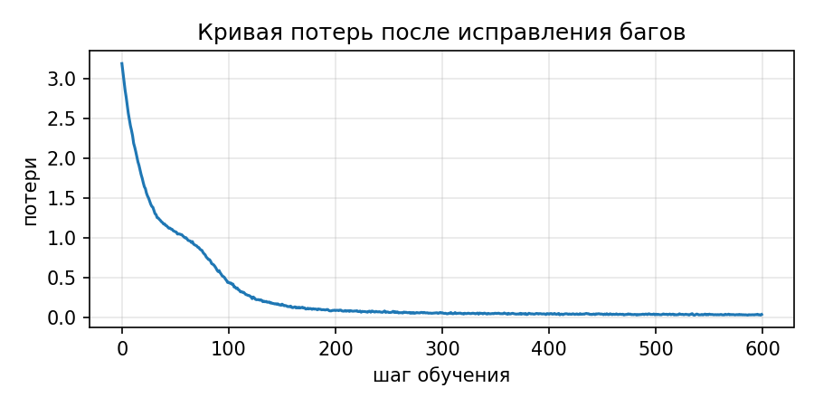

# Отчёт по ДЗ 1 «Внимание своими руками»

## 1. Реализация четырёх функций (`dz1-attention.ipynb`)

Итог прогона проверок: **пройдено 17 из 17, все проверки зелёные.**

| Функция | Что делает и почему именно так |
|---|---|
| `split_heads` | `(B, L, d_model)` → `view(B, L, H, d_head)` → `transpose(1, 2)` → `(B, H, L, d_head)`. Сначала режется ось признаков, поэтому голова `h` получает каналы `h·d_head … (h+1)·d_head − 1`. Сразу `view(B, H, L, d_head)` дал бы ту же форму, но смешал бы токены с каналами. |
| `merge_heads` | Обратный порядок: `transpose(1, 2)` → `contiguous()` → `view(B, L, d_model)`. После `transpose` данные лежат в памяти не по порядку, а `view` работает только с непрерывным тензором. `contiguous()` делает упорядоченную копию. |
| `scaled_dot_product_attention` | `softmax(QKᵀ / √d_k + маска) · V`. Деление на `√d_k` держит разброс логитов около 1 при любой размерности. Маска накладывается **до** softmax значением `-inf`. Softmax берётся по оси ключей (`dim=-1`), чтобы каждая строка была распределением. Dropout применяется к весам. Функция возвращает `(выход, веса)`. |
| `TransformerBlock.forward` | Pre-norm: `x = x + attn(norm1(x))`, затем `x = x + ffn(norm2(x))`. Нормализуется только вход подслоя. Сам `x` проходит по остаточной связи без изменений, поэтому градиент течёт в обход подслоёв. |

**Самое неочевидное решение в TODO 3: маска.** Её нужно применять к логитам до softmax и подставлять
именно `-inf`. Если обнулить веса после softmax, строка перестанет суммироваться к единице. Если
подставить до softmax ноль вместо `-inf`, то `exp(0) = 1`, и будущие токены получат заметный вес.
Только `-inf` до softmax даёт оба свойства сразу: `exp(-inf) = 0` убирает будущее, а нормировка
распределяет всю единицу между разрешёнными позициями.

## 2. Найденные ошибки (`dz1-bughunt.ipynb`, вариант seed 42, ошибок — 3)

До исправления пройдено **7 из 17** проверок, после исправления **17 из 17**. Каждую ошибку я
проверил по отдельности: в копии кода оставлял только её одну и смотрел, какие проверки падают.
Так видно, что ошибки независимы и других в коде нет.

| # | Где (функция, строка) | Механизм поломки и почему это меняет результат | Как исправлено | Какие проверки роняет одна эта ошибка |
|---|---|---|---|---|
| 1 | `sinusoidal_positional_encoding`, `position = torch.arange(1, length + 1, ...)` | Позиции нумеруются с 1 вместо 0. Каждый токен получает вектор позиции своего соседа справа, а вектора для позиции 0 (`sin = 0`, `cos = 1`) в модели нет. Кодирование расходится с формулой из «Attention is All You Need». Модель при этом учится, потому что сдвиг одинаков для всех позиций и относительные расстояния сохраняются, поэтому ошибка тихая. Но абсолютные позиции съехали на одну, и всё, что опирается на стандартное кодирование, получает не тот вход. | `torch.arange(length, ...)`: отсчёт с нуля. | «позиционное кодирование совпадает с формулой», «нулевая позиция закодирована нулевой позицией» |
| 2 | `LayerNorm.forward`, `x.mean(dim=0, ...)` и `x.var(dim=0, ...)` | Среднее и дисперсия считаются по оси батча, то есть по разным примерам, а не по `d_model` признакам одного токена. Получается разновидность batch norm, а не layer norm. Вектор токена после нормы не центрирован и не имеет единичной дисперсии, а его значение зависит от чужих примеров в батче: один пример с большими числами сдвигает нормировку всех остальных. При батче из одного примера (так работает генерация) `x − mean = 0`, и норма стирает сигнал полностью. Все логиты становятся равны, `top_k = 1` не может выбрать лучший токен, и генерация становится случайной. | `dim=-1` в обеих строках: каждый токен нормируется по своим признакам. | обе проверки LayerNorm, «при top_k=1 генерация совпадает с argmax», «генерация переводит модель в режим инференса» (две последние падают как следствие стёртого сигнала) |
| 3 | `scaled_dot_product_attention`, `torch.softmax(scores, dim=-2)` | Softmax взят по оси запросов, то есть по столбцам матрицы `L × L`, а не по ключам (строкам). В единицу суммируется столбец, а строка токена `i` перестаёт быть распределением по тем, на кого он смотрит. Выход токена — уже не взвешенное среднее value, а сумма с произвольным общим весом. Кроме того, знаменатель softmax для столбца `j` собирается по всем запросам `i ≥ j`, включая будущие токены. Поэтому будущее протекает в прошлые позиции, и причинная маска перестаёт защищать от подглядывания. | `dim=-1`: каждая строка весов — распределение над ключами, будущее в неё не попадает. | сверка с эталоном PyTorch, «веса суммируются к единице», «масштаб от √d_k», «маска обнуляет запрещённые позиции», «модель не подглядывает в будущее» |

Остальной код варианта (`split_heads`, `merge_heads`, масштаб `√d_k`, маска `-inf`, блок pre-norm,
`top_k` в `generate`, `model.eval()`) проверен и ошибок не содержит.

## 3. Обучение исправленной модели

Корпус и конфигурация взяты из ноутбука: фраза «алгоритм внимания смотрит на все позиции сразу.»,
повторённая 200 раз. Словарь из 19 символов, `d_model=128`, 4 головы, 2 слоя, `dropout=0.1`,
AdamW с `lr=3e-4`, батч 32, 600 шагов, `seed = 0`.

> В ТЗ ориентиры даны для другого корпуса: Шекспир, 62 символа, 500 шагов. Ноутбук варианта
> обучает модель на игрушечном корпусе, поэтому числа здесь другие. Логика проверки та же: старт
> около `ln(размера словаря)` и уверенное падение потерь.

| Шаг | 0 | 100 | 200 | 300 | 400 | 500 | 599 |
|---|---|---|---|---|---|---|---|
| Потери | 3,184 | 0,440 | 0,086 | 0,058 | 0,041 | 0,041 | 0,037 |

Стартовые 3,18 близки к `ln(19) = 2,94`: модель, которая ещё ничего не знает, раздаёт символам
почти равные вероятности. Небольшое превышение объясняется тем, что случайная инициализация даёт
не идеально равномерное распределение. Потери уходят почти в ноль, потому что корпус —
повторяющаяся фраза, и модель выучивает её полностью.



**Пример генерации.** Старт с символа «а», 200 новых символов, `temperature=0.8`, `top_k=10`,
`seed = 0`. Текст также сохранён в `generated_sample.txt`.

```
ания смотрит на все позиции сразу. алгоритм внимания смотрит на все позиции сразу. алгоритм внимания смотрит на все позиции сразу. алгоритм внимания смотрит на все позиции сразу. алгоритм внимания смот
```

Модель воспроизводит фразу корпуса без ошибок: слова, пробелы, точку и повторение. С багами
генерация давала случайный набор символов, потому что при батче из одного примера LayerNorm
стирал сигнал.

## 4. Окружение

**Основной прогон** — Kaggle Notebook с GPU T4, так как Colab в момент сдачи не выделял GPU. Ноутбуки
в репозитории сохранены с выводом именно этого прогона. Вывод последней ячейки `dz1-bughunt.ipynb`:

```
python   3.13.16
torch    2.11.0+cu130
platform Linux-6.18.55+-x86_64-with-glibc2.39
cuda     True Tesla T4
seed     0 (обучение и генерация)
```

**Контрольный прогон** — локально, на CPU:

```
python   3.13.7
torch    2.12.1+cpu
platform Windows-11-10.0.22631-SP0
cuda     False
```

Оба прогона дали одинаковый результат вплоть до последнего знака: все 17 проверок в обоих
ноутбуках, потери `3.1844 → 0.037` и одинаковый текст генерации. Это подтверждает
воспроизводимость, причём при разных ОС и версиях PyTorch. Цикл обучения в ноутбуке работает на CPU,
поэтому от наличия GPU результат не зависит. Код специфики Kaggle не содержит и в Colab запускается
без изменений. Инструкция по воспроизведению — в `README.md`.
